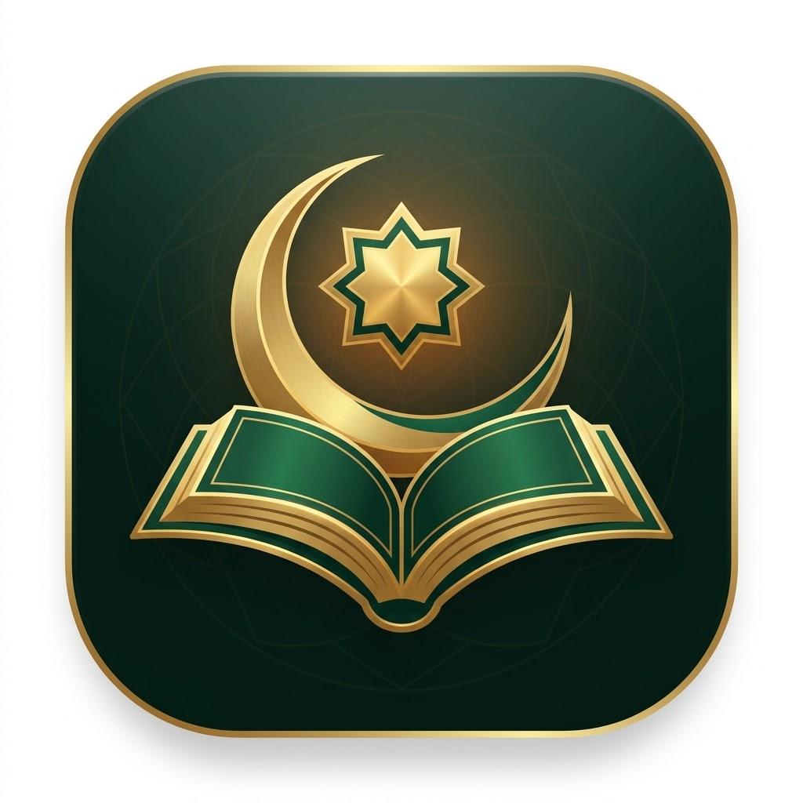

<div align="center">



# Ruhani • رُوحَانِي
### The Modern Islamic Web Sanctuary

**A serene, ad-free Islamic web platform crafted with spiritual elegance, authentic data, and modern web architecture.**

<br/>

[](https://ruhani.zvex.site)
[](https://discord.gg/XTPc3QSM4B)
[](https://ruhani.zvex.site)
[](LICENSE)
[](https://ruhani.zvex.site)

<br/>

[**🌐 Open Live Website**](https://ruhani.zvex.site) • [**💬 Join Discord**](https://discord.gg/XTPc3QSM4B) • [**✨ Report Bug / Request Feature**](https://github.com/zvexdev/ruhani-web/issues)

<br/>

---

### **بِسْمِ اللَّهِ الرَّحْمَٰنِ الرَّحِيمِ**
*«وَذَكِّرْ فَإِنَّ الذِّكْرَىٰ تَنفَعُ الْمُؤْمِنِينَ»*
> *"And remind, for indeed the reminder benefits the believers."* — **Surah Adh-Dhariyat [51:55]**

---

</div>

<br/>

## 🌿 What is Ruhani?

**Ruhani** (رُوحَانِي — *Spiritual*) is an all-in-one Islamic web sanctuary built to bring tranquility and barakah into daily life. Whether you want to read the Holy Quran in Mushaf format, listen to soulful recitations by **Sheikh Yasser Al-Dosari**, keep track of exact prayer times wherever you travel, practice daily morning and evening Adhkar with a soothing digital Tasbeeh, or reflect upon the 99 Names of Allah — Ruhani offers an uncluttered, modern, and respectful experience on every device.

- 🚫 **100% Ad-Free & Respectful**: No popups, no trackers, no distractions.
- 📱 **Designed for Mobile & Desktop**: Fluid responsive UI for phones, tablets, and laptops.
- 🌐 **Instant Bilingual Toggle**: Native Arabic by default (RTL) with one-click English (LTR).
- 📴 **Offline Resilient**: Local fallbacks for all Surahs, 99 Names, and daily Adhkar.

<br/>

---

## ✨ Features at a Glance

| Feature | Description | Shortcut |
|:---|:---|:---:|
| 📖 **The Holy Quran** | Full 114 Surahs in continuous Mushaf page view or verse-by-verse mode with translations, Tafsir drawer, dynamic font scaler, and audio playback. | `/quran` |
| 🎧 **Quran Audio Streamer** | High-definition recitations from 15 esteemed Qaris, featuring **Sheikh Yasser Al-Dosari** by default, with persistent bottom audio player. | `/audio` |
| ⏱️ **Prayer Times** | Precise astronomical solar calculations for Fajr, Sunrise, Dhuhr, Asr, Maghrib, and Isha with live countdown to the next prayer. | `/prayer` |
| 🧭 **Qibla Compass** | Great-circle Kaaba locator with live heading direction and kilometer distance to Makkah. | `/qibla` |
| 📿 **Tasbeeh & Adhkar** | Tactile digital counter with wooden-bead acoustics and haptic feedback, plus authentic Morning & Evening Adhkar from Hisn al-Muslim. | `/zikr` |
| ✨ **99 Names of Allah** | Beautiful Asma ul-Husna cards with Arabic calligraphy, transliterations, audio pronunciation, and interactive memorization progress tracker. | `/names` |
| 📜 **Hadith Compilations** | Canonical collections from Bukhari, Muslim, Tirmidhi, Abu Dawud, and 40 Hadith Nawawi with instant search and authenticity grades. | `/hadith` |

<br/>

---

## 🎙️ 15 World-Class Reciters

Stream soulful, crystal-clear recitations across the entire Holy Quran:

| # | Reciter | Audio Source |
|:---:|:---|:---|
| 👑 | **Sheikh Yasser Al-Dosari** *(Default)* | EveryAyah HD CDN |
| 2 | **Sheikh Mishary Rashid Alafasy** | EveryAyah HD CDN |
| 3 | **Sheikh Abdul Rahman Al-Sudais** | EveryAyah HD CDN |
| 4 | **Sheikh Saud Al-Shuraim** | EveryAyah HD CDN |
| 5 | **Sheikh Maher Al-Muaiqly** | EveryAyah HD CDN |
| 6 | **Sheikh Abdul Basit Abdul Samad** (Murattal) | EveryAyah HD CDN |
| 7 | **Sheikh Mahmoud Khalil Al-Husary** | EveryAyah HD CDN |
| 8 | **Sheikh Mohamed Siddiq Al-Minshawi** | EveryAyah HD CDN |
| 9 | **Sheikh Saad Al-Ghamdi** | EveryAyah HD CDN |
| 10 | **Sheikh Abu Bakr Al-Shatri** | EveryAyah HD CDN |
| 11 | **Sheikh Nasser Al-Qatami** | EveryAyah HD CDN |
| 12 | **Sheikh Ali Al-Huthaify** | EveryAyah HD CDN |
| 13 | **Sheikh Abdullah Basfar** | EveryAyah HD CDN |
| 14 | **Sheikh Ahmad Al-Ajmy** | EveryAyah HD CDN |
| 15 | **Sheikh Salah Al-Budair** | EveryAyah HD CDN |

<br/>

---

## ⚡️ Quick Start for Developers

Get Ruhani running locally on your computer in under **60 seconds**:

### 1. Clone the repository
```bash
git clone https://github.com/zvexdev/ruhani-web.git
cd ruhani-web/app
```

### 2. Install dependencies
```bash
npm install
```

### 3. Start development server
```bash
npm run dev
```

Visit [`http://localhost:3000`](http://localhost:3000) in your browser!

### 4. Build for production
```bash
npm run build
```

The optimized static assets will be created in `app/dist/`.

<br/>

---

## 🛠️ Built with Modern Technologies

- **Frontend Core**: [React 19](https://react.dev) + [TypeScript](https://www.typescriptlang.org)
- **Bundler & Tooling**: [Vite 7](https://vitejs.dev)
- **Styling**: [Tailwind CSS](https://tailwindcss.com) + Theme Variables (Midnight Oasis & Daylight Ivory)
- **Audio Engine**: Web Audio API (tactile synthesized clicks) + EveryAyah CDN
- **Data APIs**: [UmmahAPI](https://ummahapi.com) for Islamic datasets & prayer mathematics
- **Motion**: [Framer Motion](https://www.framer.com/motion/)
- **Icons**: [Lucide React](https://lucide.dev)
- **Typography**: Authentic Arabic (`Amiri`, `Cairo`, `Scheherazade New`) & English (`Plus Jakarta Sans`)

<br/>

---

## ☁️ Deploy Your Own Instance

Deploying Ruhani to [Vercel](https://vercel.com) takes less than 2 minutes:

1. Fork this repository to your GitHub account.
2. In Vercel, click **"Add New Project"** and select `ruhani-web`.
3. Set **Root Directory** to `app`.
4. Click **Deploy**. Vercel will build and launch your site with automatic HTTPS!

For custom domains (like `ruhani.zvex.site`), add a `CNAME` record pointing your subdomain to `cname.vercel-dns.com`.

<br/>

---

## 💬 Community & Support

Have questions, suggestions, or want to contribute?
- **Discord Server**: Join our friendly community at **[discord.gg/XTPc3QSM4B](https://discord.gg/XTPc3QSM4B)**
- **Creator**: Built by **[zvex](https://github.com/zvexdev)**
- **Issues**: Found a bug or typo? [Open an issue](https://github.com/zvexdev/ruhani-web/issues)

<br/>

---

## 🤲 Dedication & Sadaqah Jariyah

> This project was created with love and humility for the worldwide Muslim Ummah. All spiritual reward is dedicated solely to seeking the pleasure of Allah (*Subhanahu wa Ta'ala*).

*May Allah accept this humble work, grant peace to all who read and listen, and make it an ongoing charity (Sadaqah Jariyah) for everyone involved.*

<div align="center">

**Made with ❤️ by [zvex](https://discord.gg/XTPc3QSM4B) for the Muslim Ummah.**

</div>
